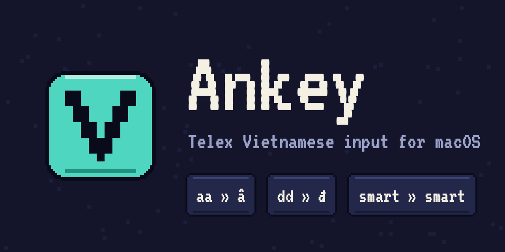

# Ankey



Ankey là bộ gõ Telex cho macOS.

Chạy trên Apple silicon, macOS 13 trở lên. Không dùng thư viện bên ngoài. Phần lõi khoảng 1.300 dòng Swift.

## Cài đặt

```
curl -fsSL https://raw.githubusercontent.com/nguyenvanduocit/ankey/main/install.sh | sh
```

Đăng xuất rồi đăng nhập lại, sau đó thêm **Ankey** ở System Settings → Keyboard → Input Sources → Edit… → **+** → Vietnamese.

Lần đầu mở, Ankey hiện cửa sổ **Hướng dẫn** gồm ba bước: bật Ankey, gõ thử, và các mẹo. Sau đó, menu bộ gõ → **Trợ giúp…** mở danh sách mã gõ nhanh và phần hỏi đáp.

## Khi nào Ankey giữ nguyên từ tiếng Anh

Chỉ dựa vào luật Telex thì chưa đủ: `test` thành `tét`, `does` thành `doé` đều đúng luật. Vì vậy Ankey kiểm tra thêm bốn lớp.

**1. Phải là âm tiết tiếng Việt.** [`Syllables.swift`](Core/Syllables.swift) chứa danh sách âm tiết tiếng Việt lấy từ Viet74K và hunspell-vi. Chữ sau khi đặt dấu chỉ được chấp nhận nếu khớp với phần đầu của một âm tiết trong danh sách. `doé` không có trong danh sách nên giữ nguyên là `does`.

**2. Danh sách từ tiếng Anh.** Có những từ tiếng Anh đặt dấu xong lại ra âm tiết tiếng Việt hợp lệ (`reset` → `rết`, `test` → `tét`). [`English.swift`](Core/English.swift) sinh tự động: lấy 20.000 từ tiếng Anh thông dụng nhất, giữ lại những từ mà engine sẽ đặt dấu, rồi xếp hạng dạng đã đặt dấu theo tần suất xuất hiện trong tiếng Việt (FrequencyWords, vi).

| Tần suất của dạng đã đặt dấu trong tiếng Việt | Kết quả |
|---|---|
| Top 500 | Không đưa vào danh sách, ưu tiên tiếng Việt: `cos` ra `có`, `nos` ra `nó`. |
| Hạng 500 đến 8000 | Chỉ giữ tiếng Anh khi từ ngay trước cũng là tiếng Anh: `git commit as` giữ nguyên, `cảm own` ra `cảm ơn`. |
| Hạng 8000 trở đi, hoặc không có trong bảng tần suất | Luôn giữ tiếng Anh: `reset`, `boot`, `list`. |

**3. Ngữ cảnh từ trước đó.** Với từ lưỡng nghĩa, Ankey dựa vào từ vừa gõ trước đó là tiếng Anh hay tiếng Việt. Ngữ cảnh này được reset khi gặp dấu chấm, `!`, `?`, Return, Tab, khi chuyển app hoặc khi con trỏ nhảy sang chỗ khác, vì lúc đó các từ cũ không còn liên quan nữa. Từ dính liền với ký tự đặc biệt kiểu code (`my_var`, `user@host`, `foo.bar(x)`) giữ nguyên, trừ khi đứng sau một từ tiếng Việt, nên `ừm...tôi` vẫn đặt dấu bình thường.

**4. Học từ thao tác sửa.** Bạn xoá cả từ rồi gõ lại y hệt, Ankey hiểu là mình đã đoán sai. Gõ `sex` ra `sẽ`, xoá đi gõ lại `sex`: Ankey hiện `sex` luôn và ghi nhớ khi bạn kết thúc từ. Ngược lại cũng vậy: muốn `tét` thay vì `test` thì xoá rồi gõ lại. Ankey chỉ ghi nhớ khi đủ ba điều kiện:

- xoá hết cả từ rồi gõ lại đúng y chuỗi phím cũ;
- từ dài từ ba ký tự trở lên;
- từ có trong danh sách tiếng Anh của Ankey (`banj` hay `tooi` không phải tiếng Anh nên không bao giờ bị giữ nguyên).

Sửa lỗi chính tả (`sex` thành `sez`), gõ thêm thành từ dài hơn (`sexy`) hay chỉ xoá một phần thì Ankey không ghi nhớ. Các từ đã học nằm ở tab Chung trong Cài đặt, xoá là Ankey quên.

Lớp 2, 3, 4 gộp lại thành một điểm số cho mỗi từ: điểm có sẵn theo hạng (0, 1, 2), cộng 1 nếu từ trước là tiếng Anh, cộng điểm học được từ thao tác sửa. Điểm từ 2 trở lên thì giữ nguyên chữ đã gõ. Thao tác sửa đẩy điểm về hẳn một phía (+2 hoặc −2), nên từ đó đổi chiều bất kể từ đứng trước là gì.

Chữ cái dính liền một chữ số (`arm64`) giữ nguyên như đã gõ. Các từ hai chữ cái hay gặp khi viết code (`ex`, `er`, `aws`) cũng vậy; `os` và `es` theo ngữ cảnh như `as`.

Gõ phím dấu hai lần thì Ankey đoán bạn muốn huỷ dấu hay gõ một từ có hai chữ cái giống nhau. Từ vừa hiện tiếng Việt (`as` ra `á`) rồi bạn bấm thêm phím dấu, mà từ ngắn hơn là tiếng Anh còn từ dài không có trong danh sách, thì phím đó huỷ dấu: `ass` ra `as`, `coss` ra `cos`, `carr` ra `car`. Từ dài là tiếng Anh có trong danh sách (`boss`, `pass`, `loss`) thì giữ nguyên hai chữ cái, và từ đang hiện đúng như gõ (`his`) cũng vậy nên `hiss` giữ nguyên. Muốn gõ `ass`, bấm phím dấu lần thứ ba (`asss` ra `ass`, `cosss` ra `coss`) hoặc bấm Esc khi đang hiện `as`. Riêng phím mũ (`oo`, `ee`, `w`) gõ thêm một lần thì bỏ mũ (`tooo` ra `too`).

Các danh sách này nằm trong code chứ không lưu vào settings, nên mỗi lần cập nhật ai cũng nhận được bản mới, kể cả người đã chỉnh settings riêng.

## Render từ phím thô

Engine không sửa chữ đang hiện trên màn hình. Nó giữ **các phím thô đã gõ từ lần ngắt từ gần nhất** và render lại cả từ sau mỗi phím. Undo, backspace và việc trả về tiếng Anh đều suy ra từ cách làm này:

- Backspace bỏ phím thô cuối rồi render lại.
- `noww` ra `now` vì engine thấy đủ bốn phím, không phải một chữ `nô` đã chuyển dở.
- Esc trả về phím thô. Nếu Ankey đã đổi `test` thành `tét`, một lần Esc cho lại `test`.
- Shift+Esc đảo cách đọc của từ đang gõ và giữ từ mở: `test` giữ nguyên thì ra `tét`, `có` thì ra `cos`, bấm lần nữa để quay lại. Gõ thêm hoặc xoá một phím thì từ đọc lại từ đầu. Từ chỉ có một cách đọc (`hello`) không đổi. Shift+Esc không dạy Ankey gì; muốn Ankey nhớ thì xoá cả từ rồi gõ lại.

## Tài nguyên

Tab Thống kê trong Cài đặt có mục Tài nguyên: bộ nhớ (kèm mức đỉnh), CPU, số luồng, thời gian chạy và kích thước chỉ mục gợi ý của chính Ankey, cập nhật mỗi giây khi tab mở, kèm biểu đồ 60 giây gần nhất. Số đo chỉ nằm trên máy, không lưu và không gửi đi. Nếu nghi Ankey ngốn RAM, mở tab này vài lần trong ngày và nhìn dòng Bộ nhớ.

## Gợi ý cụm từ

Sau một từ trở lên cách nhau bằng dấu cách, nếu các từ vừa gõ gần như luôn được theo sau bởi cùng một chuỗi âm tiết thì Ankey hiện chuỗi đó ngay sau con trỏ, gạch chân như chữ đang gõ (`cuộc chiến thương` hiện `mại`, `ung` hiện `thư`), và Tab đưa nó vào văn bản. Esc và Backspace chỉ tắt gợi ý, không gửi phím cho ứng dụng. Gõ tiếp, bấm phím khác hoặc bấm chuột thì gợi ý biến mất. Ứng dụng đặt ở chế độ chèn trực tiếp không có gợi ý, vì Chrome và các app Chromium chỉ coi Tab và Esc là của bộ gõ khi đang có chữ gạch chân. Tắt ở Cài đặt, mục Gợi ý cụm từ.

Danh sách [`Resources/phrases.txt`](Resources/phrases.txt) không phải từ điển. Nó là các cụm đếm được từ khoảng 100 triệu từ tiếng Việt thật (phụ đề OpenSubtitles và văn bản web CCMatrix), do [`tools/phrases/ngrams.py`](tools/phrases/ngrams.py) tạo ra. Một âm tiết chỉ được gợi ý khi nó đứng sau các từ đã gõ trong ít nhất 99% lần xuất hiện, hoặc 95% nếu nó hoàn thành một từ ghép trong từ điển Viet74K. Chuỗi gợi ý dài đến khi tỉ lệ đó còn giữ được. Chỗ nào các cụm tách nhau thì Ankey không gợi ý. Từ tục được lọc khỏi danh sách.

Trên văn bản giữ riêng chưa dùng để đếm, gợi ý đúng 97 đến 98% (hội thoại và web) và 97% trên văn xuôi Wikipedia, và hiện ở khoảng 2 đến 4% số từ gõ. Số này đo ở bước tạo danh sách, không phải trong lúc gõ thật.

### Học cụm từ của bạn

Danh sách chung không có tên dự án hay thuật ngữ của riêng bạn. Bật "Học cụm từ bạn hay gõ" trong Cài đặt thì Ankey đếm những cụm bạn gõ lặp lại và gợi ý chúng, ưu tiên hơn danh sách chung. Tính năng này tắt mặc định vì nó lưu chữ bạn gõ: trong một file chỉ bạn đọc được (`~/Library/Application Support/Ankey/personal-phrases.json`), không gửi đi đâu, xem và xoá từng cụm hay xoá hết ngay trong Cài đặt.

Bộ nhớ có trần cứng, nên cái mới vào thì cái ít giá trị nhất phải ra:
- Một cụm chỉ được lưu từ lần gặp thứ hai (Ankey nhớ lần đầu bằng một bảng băm 32.768 ô, ô mới ghi đè ô cũ) và được gợi ý từ lần thứ ba. Phần lớn cụm chỉ gõ một lần nên không bao giờ chiếm chỗ.
- Tối đa 6.000 tiền tố (1 đến 3 từ), mỗi tiền tố giữ tối đa 4 từ theo sau. Tối đa khoảng 6 MB RAM và 2 MB đĩa khi đầy.
- Vượt trần thì bỏ 10% tiền tố có điểm thấp nhất. Điểm là số lần từ dẫn đầu xuất hiện (chặn ở 50) nhân bình phương tỉ lệ của nó, nhân hệ số giảm một nửa sau mỗi 45 ngày không gặp. Tiền tố mà mọi từ đều theo sau (`có`, `không`) vì thế không bao giờ giữ được chỗ, còn một tên riêng luôn theo sau bởi cùng một từ thì giữ được từ lần thứ ba.
- Số đếm cũ mờ đi theo thời gian như trên, và mỗi lần một tiền tố xuất hiện thì số đếm của nó giảm thêm 3%, nên một tiền tố chỉ nhớ khoảng 30 lần gần nhất. Cụm đã học rất chắc mà bạn đổi sang cụm khác thì Ankey thôi gợi cụm cũ sau chưa đầy chục lần và gợi cụm mới sau khoảng 50 lần, không phụ thuộc cụm cũ đã gõ bao nhiêu lần. Thói quen ổn định vẫn được nhận ra như cũ.
- Cái danh sách chung đã đoán đúng thì không lưu.

### Học khi nào bạn gõ tiếng Anh

Điểm quyết định một chữ là tiếng Anh hay tiếng Việt chỉ biết ngôn ngữ của từ liền trước. Chữ tiếng Anh đầu tiên sau chữ Việt vì thế không được giúp gì: `as` sau `tôi dùng` vẫn ra `á`. Bật "Học khi nào bạn gõ tiếng Anh" thì Ankey nhớ sau từ nào bạn thường gõ tiếng Anh hay tiếng Việt, và khi một chữ có thể là cả hai thì cộng hoặc trừ một điểm theo thói quen đó (cùng cỡ với điểm của từ liền trước). Một từ chỉ "nghiêng" khi có ít nhất 8 mẫu và 90% thuộc một thứ tiếng. Thói quen tiếng Việt không bao giờ biến một từ tiếng Anh luôn nằm trong danh sách (`test`) thành tiếng Việt.

Ankey chỉ học từ những chữ chắc chắn (không nằm trong danh sách tiếng Anh, nên điểm không quyết định chúng) và từ những lần bạn tự chọn: Esc, Shift+Esc, xoá rồi gõ lại, mỗi lần tính bằng 4 mẫu. Học từ chính các quyết định mơ hồ của Ankey sẽ tự củng cố lỗi của nó, nên không làm vậy. Bảng có trần 4.000 từ đứng trước (khoảng 1 MB), mỗi từ giữ hai bộ đếm, số đếm giảm một nửa sau 60 ngày không gặp, mỗi lần ghi thêm một mẫu thì cả hai bộ đếm giảm thêm 3% (nên một từ chỉ nhớ khoảng 30 mẫu gần nhất: thói quen đã học rất chắc mà bạn đổi hẳn thì Ankey thôi nghiêng sau chưa đầy chục lần và nghiêng sang bên mới sau khoảng 70 lần, không phụ thuộc cái cũ đã học bao nhiêu lần),, và khi đầy thì bỏ 10% từ có điểm thấp nhất, điểm là số mẫu (chặn ở 50) nhân bình phương độ nghiêng. Tắt mặc định vì file `language-habits.json` chứa các từ bạn gõ. Xem và xoá từng từ trong Cài đặt.
